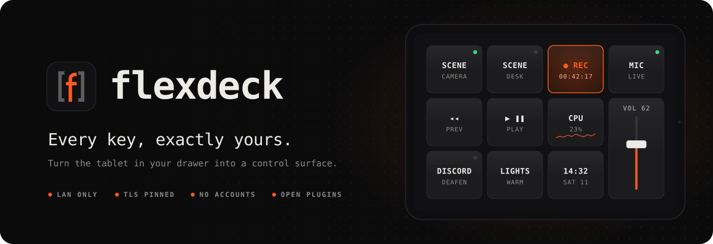
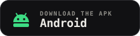
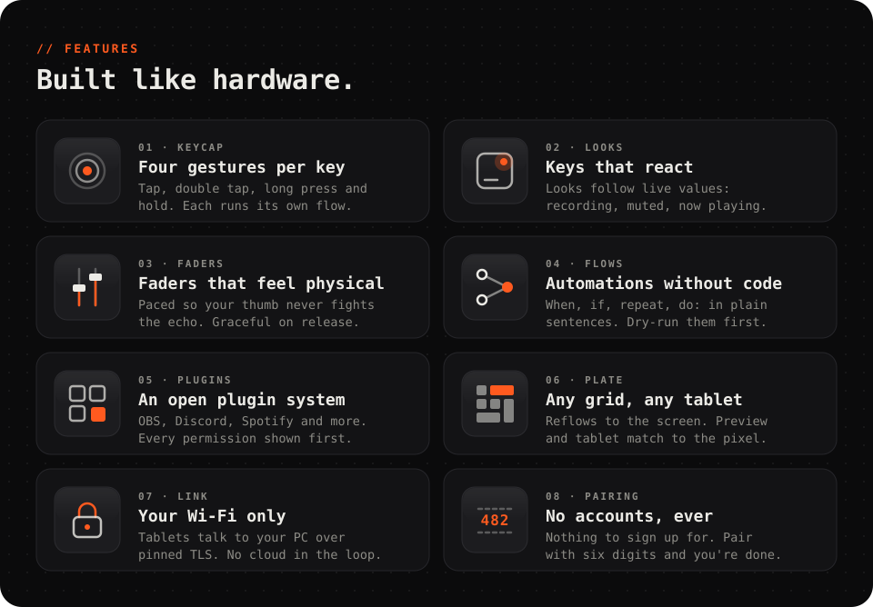
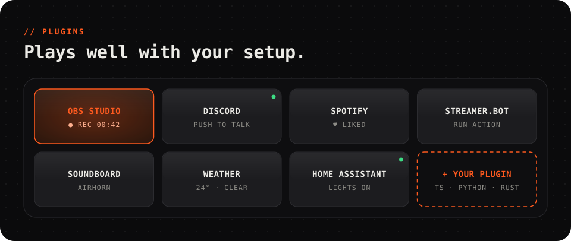
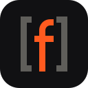

<a href="https://flex-deck.com">
  <picture>
    <source media="(prefers-color-scheme: dark)" srcset=".github/assets/banner-dark.svg">
    <source media="(prefers-color-scheme: light)" srcset=".github/assets/banner-light.svg">
    
  </picture>
</a>

<p align="center">
  <a href="https://flex-deck.com"></a>
  <a href="https://github.com/santoshpanna/FlexDeck/releases/latest"></a>
  
  
  <a href="#license"></a>
</p>

<br>

<p align="center">
  Keys, faders, live states and automations for your PC,<br>
  on the tablet you already own. <b>Your Wi-Fi. No accounts.</b>
</p>

<p align="center">
  <a href="https://github.com/santoshpanna/FlexDeck/releases/latest"></a>
  &nbsp;
  <a href="https://github.com/santoshpanna/FlexDeck/releases/latest"></a>
</p>

<p align="center">
  <sub>Windows 10 / 11 · Android 5.0+ · then edit your deck at <a href="https://flex-deck.com">flex-deck.com</a></sub>
</p>

<br>

<picture>
  <source media="(prefers-color-scheme: dark)" srcset=".github/assets/features-dark.svg">
  <source media="(prefers-color-scheme: light)" srcset=".github/assets/features-light.svg">
  
</picture>

<br><br>

<picture>
  <source media="(prefers-color-scheme: dark)" srcset=".github/assets/how-dark.svg">
  <source media="(prefers-color-scheme: light)" srcset=".github/assets/how-light.svg">
  
</picture>

<br><br>

<picture>
  <source media="(prefers-color-scheme: dark)" srcset=".github/assets/plugins-dark.svg">
  <source media="(prefers-color-scheme: light)" srcset=".github/assets/plugins-light.svg">
  
</picture>

<p align="center">
  Write your own in TypeScript, Python or Rust. <a href="docs/plugins.md"><b>Plugin guide →</b></a>
</p>

<br>

## Docs

**[Getting started](docs/getting-started.md)** · **[Plugins](docs/plugins.md)** ·
**[Architecture](docs/architecture.md)** · **[Security](docs/security.md)** ·
**[Development](docs/development.md)** · **[Releasing](docs/release.md)**

## Build from source

```sh
git clone https://github.com/santoshpanna/FlexDeck.git flexdeck && cd flexdeck
pnpm install
pnpm dev:desktop     # the desktop app
pnpm dev:web         # the web editor + relay
```

Needs Node 22+, Rust 1.88+, and JDK 17 for Android. The full setup is in
[docs/development.md](docs/development.md).

## Contributing

Issues, plugins and pull requests are welcome. Read
[CONTRIBUTING.md](CONTRIBUTING.md) first. Your first pull request asks you to sign
the [CLA](CLA.md) with a one-line comment. Report security issues privately, as
described in [SECURITY.md](SECURITY.md).

## License

[AGPL-3.0](LICENSE). The plugin SDKs, the plugin contract and the plugin template
are [MIT](packages/plugin-sdk/LICENSE), so your plugins can use any license.

<br>

<p align="center">
  <a href="https://flex-deck.com"></a>
</p>
