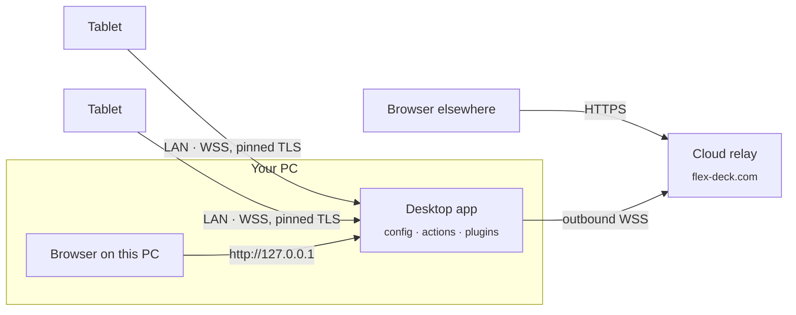

# Architecture

> Part of the [flexdeck docs](README.md).

flexdeck is three programs and a contract between them.

| Piece | What it is | Built with |
| --- | --- | --- |
| **Desktop app** | Owns the configuration and runs actions on the PC. Sits in the tray. | Rust, Tauri, SQLite |
| **Android client** | Draws the deck on a tablet and sends presses. | Kotlin, classic Views, minSdk 21 |
| **Web portal** | The editor. Configures the desktop from any browser, with no account. | React, Vite, Tailwind |
| **Cloud relay** | Serves the portal and forwards traffic for browsers that are not on the PC. Holds no accounts or credentials. | Rust |



* **On the same computer** the portal talks straight to the desktop app on
  loopback, the way a keyboard vendor's web configurator talks to the keyboard on
  your desk. It connects by itself.
* **From another device**, the desktop app shows a code under *Browsers →
  Connect a browser*; typing it into the portal pairs that browser. The desktop
  issues and checks the browser's credential; the cloud only forwards traffic.

The desktop dials **out** to the cloud and nothing dials in. That is why there is
no inbound port, no NAT rule and no port forward — and why the cloud never needs
the desktop's local address. Credentials and what each one may do are in
[security.md](security.md).

## The parity problem

The web configurator draws a live preview; the tablet draws the real thing.
Two renderers, two languages, one layout. If they disagree by a single pixel,
**the preview lies** — the user positions a button against a preview that does
not match the device.

So the grid algorithm is written once as a spec and implemented three times,
and the implementations are held together by golden fixtures:

* `contract/fixtures/grid/*.json` — inputs (grid spec + widget spans)
* `contract/fixtures/grid/*.expected.json` — the exact integer rectangles
  every renderer must produce

The expectations are generated from the TypeScript reference implementation and
then asserted by the Rust and Kotlin suites. Three CI jobs, one contract.

**Rules the algorithm depends on** (documented in `packages/grid/src/index.ts`):

1. Integer arithmetic only — no floats, ever.
2. The gap borders both outer edges *and* sits between cells: `n` cells have
   `n + 1` gaps.
3. Remainder pixels go to the first `remainder` cells, left to right.
4. A spanning widget covers the gaps inside it.

## Key decisions

| Decision | Choice | Why |
| --- | --- | --- |
| Type contract | `proto3`, compiled to TS/Rust/Kotlin | One schema; proto3's **JSON mapping is specified**, so field naming stays consistent across languages for free |
| Wire format | JSON + RFC 6902 JSON-Patch | Keeps the PRD's debuggable JSON wire and cheap delta sync; the `.proto` supplies only the types |
| Grid | Integer cells, explicit per-profile layouts | Identical rects are computable in every language; no free-form CSS to drift |
| Android | Native Kotlin, classic Views, minSdk 21 | Old tablets have outdated WebViews and little RAM |
| Grid module | Pure Kotlin/JVM, not Android library | The maths is verifiable in CI without an Android SDK |

## Repository layout

```
contract/              Single source of truth
  proto/                 proto3 schema shared by all three renderers
  fixtures/              Golden fixtures — grid, faces, plugin protocol
apps/
  agent/                 The headless agent binary (`flexdeck`)
  desktop/               The desktop app: a Tauri window over the same agent
  portal/                The web editor (Vite + React), served by the cloud
crates/
  flexdeck-actions/      Action engine: hotkey parsing, desktop execution
  flexdeck-automation/   Automations: a small, bounded, visual language
  flexdeck-cloud/        Cloud relay: portal serving, tunnel, browser-code routing
  flexdeck-expr/         Templates and expressions: labels, rules, recipe values
  flexdeck-grid/         Grid algorithm + parity test (Rust)
  flexdeck-pairing/      Pairing: TLS identity, PIN/QR windows, device tokens
  flexdeck-plugin/       Plugin registry and the built-in plugins
  flexdeck-plugin-abi/   The plugin contract: manifest, messages, plugin.json
  flexdeck-plugin-host/  Runs an installed plugin as a supervised process
  flexdeck-plugin-sdk/   Write a native plugin in Rust
  flexdeck-protocol/     Generated proto3 types + proto3 JSON mapping
  flexdeck-server/       Agent server: sync core, REST API, WebSocket hub
  flexdeck-store/        SQLite config store: revision log, undo/redo, patch diff
  flexdeck-tunnel/       Outbound tunnel: frame codec + request correlation
  flexdeck-vars/         Typed, namespaced live variables
packages/
  grid/                  Grid algorithm (TypeScript reference implementation)
  face/                  Key faces: which face a key shows and where things fall
  ui/                    Shared interface kit, motion presets, ASCII engine, the mark
  tokens/                Design tokens shared by the portal and the desktop window
  plugin-sdk/            Write plugins in TypeScript: SDK, test harness, packer
  plugin-sdk-python/     Write plugins in Python (published as `flexdeck-plugin`)
  create-flexdeck-plugin/ `npm create flexdeck-plugin`
plugins/                 First-party plugins: OBS, Discord, Spotify, Streamer.bot, …
recipes/                 Plugins without code: weather, calendar, crypto, Home Assistant
android/
  app/                   The tablet client: pairing, deck renderer, TLS pinning
  core/grid/             Grid algorithm + parity test (Kotlin, pure JVM)
  core/client/           Wire frames, JSON Patch, session, gestures (pure JVM)
scripts/                 Dev launchers, icon and artwork generators
docs/                    You are here
```

Client-side proto codegen is still absent: only the Rust side is generated (see
`crates/flexdeck-protocol/build.rs`). `buf` is not installed, so `contract/buf.gen.yaml`
is not the working codegen path.
